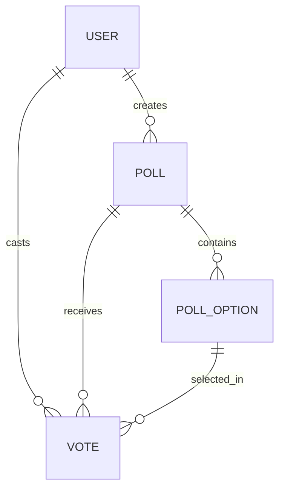

# Polls 📊

A Spring Boot REST API for creating polls, collecting votes, and tracking results in real time.

## ✨ Features

- Create users and polls with multiple options.
- Register users and authenticate through email and password.
- Use the React frontend for login, registration, profiles, poll creation, voting, and results.
- Start every new poll in the `OPEN` state.
- Finish polls manually or automatically when `finishDate` is reached.
- Allow one vote per user for each poll.
- Validate that a selected option belongs to the poll being voted on.
- Update option vote counts in the same transaction as the vote.
- Return a descending ranking, percentages, total votes, and all tied winners.
- Stream result updates to connected clients with Server-Sent Events (SSE).

## 🧰 Technology

- Java 25
- Spring Boot 4.2.0-M2
- Spring MVC, Spring Data JPA, and Jakarta Bean Validation
- MySQL 8.4
- Docker Compose
- Maven Wrapper
- React 19 and React Router
- Tailwind CSS 4
- Vite

## 🚀 Getting started

### Requirements

- JDK 25
- Node.js 20 or newer
- Docker Desktop with Docker Compose
- No separate Maven installation is needed; use the included wrapper.

### Run the application with Docker

Copy the example environment file, then build and start the API and MySQL:

```powershell
if (-not (Test-Path .env)) { Copy-Item .env.example .env }
docker compose up --build -d
```

On macOS or Linux:

```bash
test -f .env || cp .env.example .env
docker compose up --build -d
```

The API is available at `http://localhost:8080`. MySQL is exposed on host port `3308` by default (change `MYSQL_PORT` in `.env` if needed), and its data is persisted in the `mysql-data` Docker volume. The credentials in `.env.example` are for local development only; change them before exposing the services to other users or networks.

To run the application directly with Maven instead, start MySQL with `docker compose up -d mysql`, then run `.\mvnw.cmd spring-boot:run` on Windows or `./mvnw spring-boot:run` on macOS/Linux.

Stop the application and database with `docker compose down`.

### Run the React frontend

In a second terminal, install the frontend dependencies and start Vite:

```powershell
cd frontend
npm install
npm run dev
```

The frontend is available at `http://localhost:5173`. It expects the API at `http://localhost:8080` by default.

To use a different API address, copy the example environment file before starting Vite:

```powershell
cd frontend
Copy-Item .env.example .env
```

Then set `VITE_API_URL` in `frontend/.env` if necessary.

### Run everything locally

From the repository root, start MySQL and the API with Docker:

```powershell
docker compose up --build -d
```

In another terminal, start the React frontend:

```powershell
cd frontend
npm install
npm run dev
```

Open `http://localhost:5173` in the browser. Use `docker compose logs -f app` to view the API logs and `docker compose down` to stop the Docker services.

## 🗺️ API

The examples below use `http://localhost:8080` as the base URL. Dates use ISO local date-time format (`yyyy-MM-dd'T'HH:mm:ss`) and do not include a timezone.

### Users

#### Create a user

```http
POST /users
Content-Type: application/json
```

```json
{
  "name": "Alex Morgan",
  "email": "alex@example.com",
  "password": "secret123"
}
```

#### Login

```http
POST /users/login
Content-Type: application/json
```

```json
{
  "email": "alex@example.com",
  "password": "secret123"
}
```

### Polls

#### Create a poll

The creator is supplied as a query parameter. Options are created atomically with the poll.

```http
POST /poll?userId=1
Content-Type: application/json
```

```json
{
  "title": "Team lunch",
  "question": "Where should we go?",
  "finishDate": "2026-11-18T21:00:00",
  "options": [
    "Italian",
    "Japanese",
    "Mexican"
  ]
}
```

Polls require at least two non-empty options and a future `finishDate`.

#### List polls

```http
GET /polls
```

#### Get poll details

```http
GET /poll/{pollId}
```

The response includes the poll status, creator ID, dates, and options with their current vote counts.

### Votes and results

#### Vote

```http
POST /polls/{pollId}/vote
Content-Type: application/json
```

```json
{
  "userId": 1,
  "optionId": 2
}
```

The response contains the updated poll results. A user may vote only once per poll. The API rejects votes for closed or expired polls and options that do not belong to the requested poll.

#### Get results

```http
GET /polls/{pollId}/results
```

Example response:

```json
{
  "pollId": 7,
  "title": "Team lunch",
  "status": "OPEN",
  "totalVotes": 4,
  "ranking": [
    {
      "optionId": 2,
      "text": "Japanese",
      "votes": 3,
      "percentage": 75.00,
      "rank": 1
    },
    {
      "optionId": 1,
      "text": "Italian",
      "votes": 1,
      "percentage": 25.00,
      "rank": 2
    }
  ],
  "winners": [
    {
      "optionId": 2,
      "text": "Japanese",
      "votes": 3,
      "percentage": 75.00,
      "rank": 1
    }
  ]
}
```

Ranking is sorted from most votes to fewest. Tied options share a rank and are all included in `winners`. When there are no votes, `winners` is empty.

#### Subscribe to live results

Use the same results URL with the `text/event-stream` media type. Browser `EventSource` sends this `Accept` header automatically.

```javascript
const source = new EventSource("/polls/7/results");

source.addEventListener("results", (event) => {
  const results = JSON.parse(event.data);
  console.log(results.totalVotes, results.ranking);
});
```

Subscribers receive the current results when they connect and an updated `results` event after each committed vote.

### Poll lifecycle

#### Finish a poll

Only the poll creator can finish it.

```http
PATCH /polls/{pollId}/finish?userId={userId}
```

#### Cancel a poll

Only the poll creator can cancel an open poll.

```http
PATCH /polls/{pollId}/cancel?userId={userId}
```

Expired polls are closed by a background task within one minute and are also marked closed when accessed. Votes are rejected as soon as the finish time has passed.

#### Delete a poll

Only the poll creator can delete it. Its options and votes are removed with it.

```http
DELETE /poll/{pollId}?userId={userId}
```

## 🗃️ Data model



The database enforces a unique `(poll_id, user_id)` pair in `votes`, preventing a user from voting twice in the same poll, including concurrent requests.

## 🧪 Tests

The integration tests exercise the HTTP endpoints against a disposable MySQL test service. Start it, run the full JUnit suite, and stop the test service:

```powershell
docker compose --profile test up -d --wait mysql-test
.\mvnw.cmd test
docker compose --profile test stop mysql-test
```

On macOS or Linux, replace `.\mvnw.cmd` with `./mvnw`. The suite covers user creation, poll creation/listing/details, voting and duplicate-vote rules, JSON results and ranking, the SSE route, finishing/cancelling polls, and deletion. It also includes focused service tests.

## ⚠️ Identity and security note

This project currently accepts `userId` from request parameters or request bodies and does not authenticate users. That makes it suitable for local development and demonstrations, but clients can claim another user's ID. Add authentication and derive the user ID from the authenticated principal before using this API in production.

## 📁 Project structure

```text
src/main/java/com/scrimet/polls/
├── polls/       # Poll endpoints, lifecycle, and result calculations
├── polloptions/ # Poll option entity, repository, and service
├── users/       # User registration and persistence
└── votes/       # Vote entity, validation, and vote persistence
```
