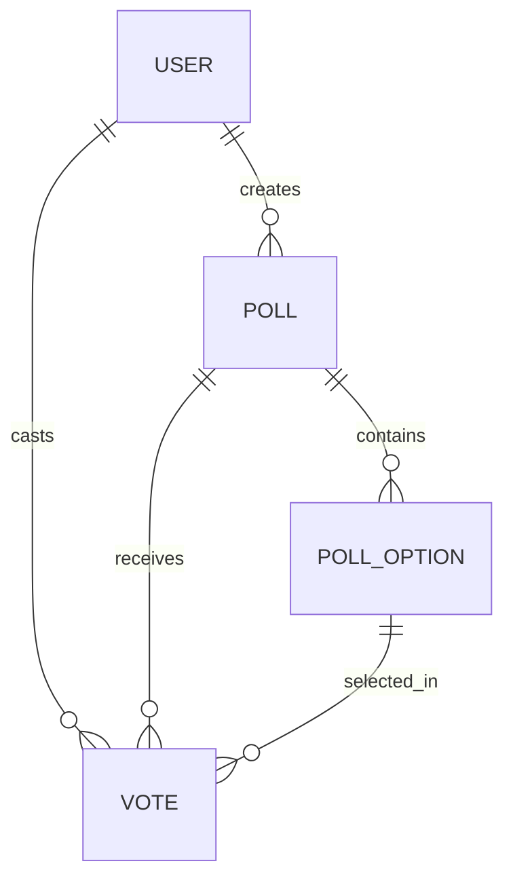

# Polls 📊

A Spring Boot REST API for creating polls, collecting votes, and tracking results in real time.

## ✨ Features

- Create users and polls with multiple options.
- Start every new poll in the `OPEN` state.
- Finish polls manually or automatically when `finishDate` is reached.
- Allow one vote per user for each poll.
- Validate that a selected option belongs to the poll being voted on.
- Update option vote counts in the same transaction as the vote.
- Return a descending ranking, percentages, total votes, and all tied winners.
- Stream result updates to connected clients with Server-Sent Events (SSE).

## 🧰 Technology

- Java 25
- Spring Boot 4.2.0-M2
- Spring MVC, Spring Data JPA, and Jakarta Bean Validation
- H2 database for local development
- Maven Wrapper

## 🚀 Getting started

### Requirements

- JDK 25
- No separate Maven installation is needed; use the included wrapper.

### Run the application

On Windows PowerShell:

```powershell
.\mvnw.cmd spring-boot:run
```

On macOS or Linux:

```bash
./mvnw spring-boot:run
```

The API is available at `http://localhost:8080`. The default H2 database is in memory, so its data is reset when the application restarts.

## 🗺️ API

The examples below use `http://localhost:8080` as the base URL. Dates use ISO local date-time format (`yyyy-MM-dd'T'HH:mm:ss`) and do not include a timezone.

### Users

#### Create a user

```http
POST /users
Content-Type: application/json
```

```json
{
  "name": "Alex Morgan",
  "email": "alex@example.com"
}
```

### Polls

#### Create a poll

The creator is supplied as a query parameter. Options are created atomically with the poll.

```http
POST /poll?userId=1
Content-Type: application/json
```

```json
{
  "title": "Team lunch",
  "question": "Where should we go?",
  "finishDate": "2026-11-18T21:00:00",
  "options": [
    "Italian",
    "Japanese",
    "Mexican"
  ]
}
```

Polls require at least two non-empty options and a future `finishDate`.

#### List polls

```http
GET /polls
```

#### Get poll details

```http
GET /poll/{pollId}
```

The response includes the poll status, creator ID, dates, and options with their current vote counts.

### Votes and results

#### Vote

```http
POST /polls/{pollId}/vote
Content-Type: application/json
```

```json
{
  "userId": 1,
  "optionId": 2
}
```

The response contains the updated poll results. A user may vote only once per poll. The API rejects votes for closed or expired polls and options that do not belong to the requested poll.

#### Get results

```http
GET /polls/{pollId}/results
```

Example response:

```json
{
  "pollId": 7,
  "title": "Team lunch",
  "status": "OPEN",
  "totalVotes": 4,
  "ranking": [
    {
      "optionId": 2,
      "text": "Japanese",
      "votes": 3,
      "percentage": 75.00,
      "rank": 1
    },
    {
      "optionId": 1,
      "text": "Italian",
      "votes": 1,
      "percentage": 25.00,
      "rank": 2
    }
  ],
  "winners": [
    {
      "optionId": 2,
      "text": "Japanese",
      "votes": 3,
      "percentage": 75.00,
      "rank": 1
    }
  ]
}
```

Ranking is sorted from most votes to fewest. Tied options share a rank and are all included in `winners`. When there are no votes, `winners` is empty.

#### Subscribe to live results

Use the same results URL with the `text/event-stream` media type. Browser `EventSource` sends this `Accept` header automatically.

```javascript
const source = new EventSource("/polls/7/results");

source.addEventListener("results", (event) => {
  const results = JSON.parse(event.data);
  console.log(results.totalVotes, results.ranking);
});
```

Subscribers receive the current results when they connect and an updated `results` event after each committed vote.

### Poll lifecycle

#### Finish a poll

Only the poll creator can finish it.

```http
PATCH /polls/{pollId}/finish?userId={userId}
```

#### Cancel a poll

Only the poll creator can cancel an open poll.

```http
PATCH /polls/{pollId}/cancel?userId={userId}
```

Expired polls are closed by a background task within one minute and are also marked closed when accessed. Votes are rejected as soon as the finish time has passed.

#### Delete a poll

Only the poll creator can delete it. Its options and votes are removed with it.

```http
DELETE /poll/{pollId}?userId={userId}
```

## 🗃️ Data model



The database enforces a unique `(poll_id, user_id)` pair in `votes`, preventing a user from voting twice in the same poll, including concurrent requests.

## 🧪 Tests

Run the complete test suite:

```powershell
.\mvnw.cmd test
```

The tests cover poll creation, voting rules, result ranking, and the HTTP voting flow.

## ⚠️ Identity and security note

This project currently accepts `userId` from request parameters or request bodies and does not authenticate users. That makes it suitable for local development and demonstrations, but clients can claim another user's ID. Add authentication and derive the user ID from the authenticated principal before using this API in production.

## 📁 Project structure

```text
src/main/java/com/scrimet/polls/
├── polls/       # Poll endpoints, lifecycle, and result calculations
├── polloptions/ # Poll option entity, repository, and service
├── users/       # User registration and persistence
└── votes/       # Vote entity, validation, and vote persistence
```
